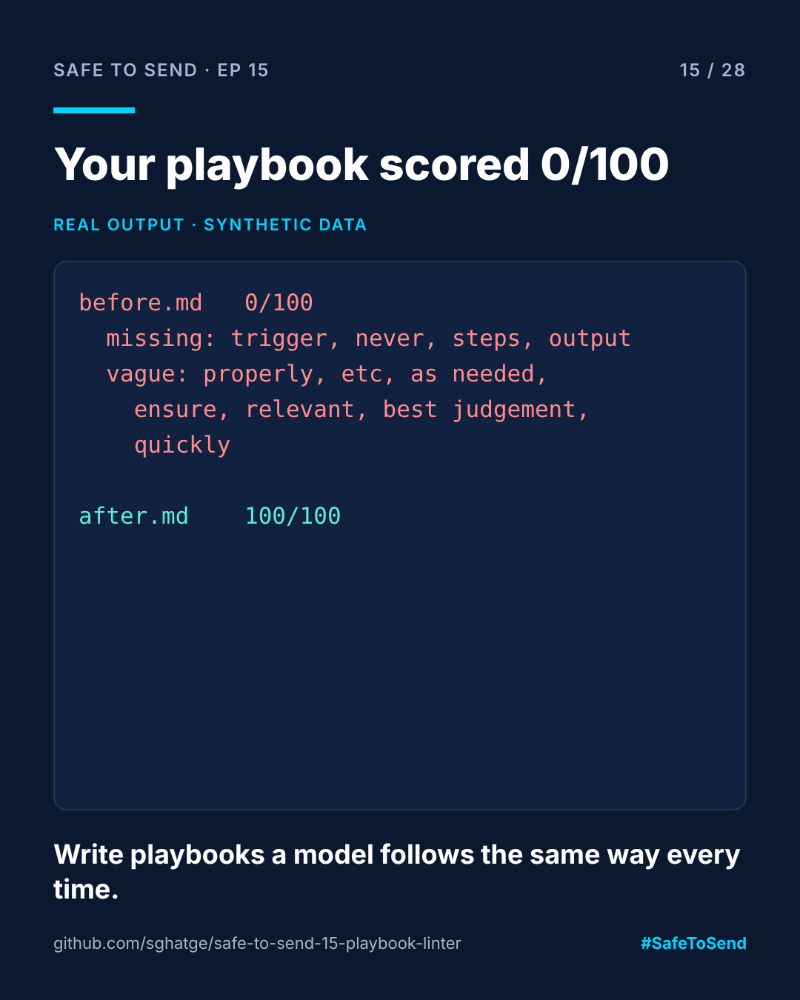

# safe-to-send-15 · Playbook Linter



**Safe to Send · Episode 15** — a 28-day learn-in-public series on governing AI in CRM operations.

> Prompt engineering for ops isn't clever wording. It's writing the playbook so precisely that a model can follow it the same way every time.

## The real-world scenario

Every CRM team has a pre-send checklist somewhere: "Check the email properly. Make sure links work, prices are right etc. Use best judgement on timing." A new colleague asks five follow-up questions. A model asks none. It just guesses, differently each time.

## The use case

Lint the playbook before a model (or a new hire) runs it. Every executable playbook needs four parts:

| Part | Question it answers |
|---|---|
| When to use | When does this apply, and to whom? |
| Never | What must it never touch or do? |
| Numbered steps | What exactly, in what order? |
| Output | What does done look like? |

Plus a vague-word check: "properly", "as needed", "etc", "ensure", "best judgement", "quickly". Words a person interprets and a model invents.

## Run it

```bash
python playbook_lint.py examples/presend_check_before.md examples/presend_check_after.md
```

## Real example output

```
examples/presend_check_before.md: 0/100
   missing  trigger
   missing  guardrails
   missing  steps
   missing  output
   vague    line 3: 'properly' -> Check the email properly. ...
   vague    line 3: 'etc' -> ...
   ...
examples/presend_check_after.md: 100/100
```

The rewrite took ten minutes. Notice that the hardest section to write was **Never**, not the steps.

## Use it in CI

Exit code 1 if any playbook scores under 80. Point it at your skills folder.

MIT · [Sangram Ghatge](https://www.linkedin.com/in/sangram-g-2369705b) · #SafeToSend
